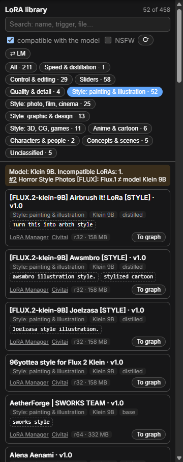

# ESCA LoRA Lab

**Библиотека LoRA, встроенная в ComfyUI.** Работает поверх
[ComfyUI LoRA Manager](https://github.com/willmiao/ComfyUI-Lora-Manager): он остаётся
основным менеджером (страница `/loras`, загрузка с Civitai, рецепты, узлы с триггерами), а
модуль добавляет то, что нужно большой библиотеке.

| Возможность | Что делает |
|---|---|
| **Панель в сайдбаре** | Поиск, фильтр по назначению, «только совместимые с моделью графа», NSFW скрыт по умолчанию, копирование триггеров. LoRA перетаскивается на холст или кнопкой «В граф» уходит в узел LoRA Manager — через его же канал `update-lora-code`, вместе с триггерами |
| **Истинная архитектура** | По формам тензоров заголовка (ширина, раскладка блоков, LoKr): Klein 9B / Klein 4B / Flux.2 Dev / Flux.1 / SDXL / SD 1.5 / Z-Image, а не по имени файла. Модели (в том числе GGUF) определяются так же |
| **Страж совместимости** | Следит за графом и предупреждает, если LoRA не подходит к загруженной модели (такая LoRA молча ничего не делает) |
| **Таксономия → LoRA Manager** | Теги `esca:*` (назначение, архитектура, base/distilled), исправленный `base_model` в каноничных названиях LoRA Manager, блок `[ESCA] … [/ESCA]` в заметках, триггеры для LoRA без них. Идемпотентно; чужие теги и заметки не трогаются |
| **Обратимая реорганизация** | По желанию: `flux2/klein/<назначение>/`, `flux2/dev/<назначение>/`, `flux1/`, `sdxl/`, `sd15/`… через LoRA Manager (сайдкары и превью переезжают с моделью); пути LoRA в воркфлоу переписываются с резервными копиями; откат одной командой по журналу |
| **Студия превью** | Единые примеры для каждой LoRA на вашей модели: одинаковые сцены и сиды, слайдеры — в обе стороны. Запуск только кнопкой «Старт»; пауза и стоп; очередь в SQLite переживает перезапуск; ключ задачи — SHA-256 LoRA, поэтому повторное планирование ничего не дублирует, а перенос файлов не теряет сделанное. Вежливый режим уступает GPU вашим задачам |



## Установка

```bash
cd ComfyUI/custom_nodes
git clone https://github.com/nkVas1/comfyui-esca-lora-lab.git
```

Перезапустите ComfyUI и откройте вкладку **LoRA** в левом сайдбаре. Язык интерфейса
следует настройке языка ComfyUI.

Требуется ComfyUI с новым фронтендом (проверено на 0.11 / фронтенд 1.37) и LoRA Manager ≥
1.2.6 для синхронизации, реорганизации и отправки LoRA в граф.

## Настройки

`ComfyUI/user/esca-lora-lab/settings.json` (создаётся при первом запуске и не теряется при
обновлении): исключаемые папки (`excluded_dirs`), язык тегов и заметок (`language`: `en`/`ru`),
область реорганизации (`reorg_scope`), дополнительные папки воркфлоу, кэши Civitai и ручные
правки классификации (`title_overrides`, `path_overrides`). Подробная таблица — в
[README.md](README.md#configuration).

Пресеты студии — `presets/previews.*.json` (примеры); свои кладите в
`ComfyUI/user/esca-lora-lab/presets/`, пресет с тем же `id` заменяет встроенный.

## Лицензия

[GPL-3.0](LICENSE) — как у ComfyUI и LoRA Manager.
